# NyayaFlow

**Court case lifecycle management for registries, benches and the bar.**

**[Live demo](https://nyayaflow-lsm2.onrender.com)** · sign in with the one-click demo accounts (password `Demo@123`). Hosted on a free plan, so the first request after a quiet spell can take about a minute while the server wakes up.


Built by **Dhruv Mittal**.

NyayaFlow is a full-stack web application that keeps one authoritative record of every court case,
from the day it is filed to the day its record is consigned. Court staff register and list cases,
judges run their board and issue orders, lawyers follow their matters and file documents, and
administrators manage people and configuration. Everyone works from the same data, and each role
sees only what it needs.

> NyayaFlow is an educational and portfolio project. The courts, people and cases in it are
> fictional, and it is not intended for real judicial use.

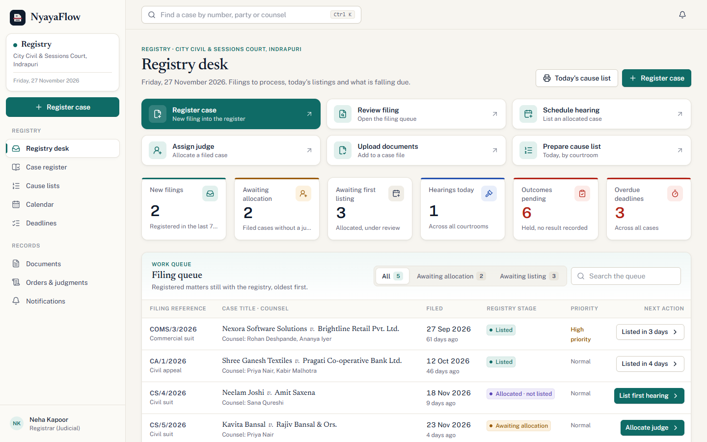

---

## Contents

- [Screenshots](#screenshots)
- [The problem](#the-problem)
- [Features](#features)
- [Roles and what they can do](#roles-and-what-they-can-do)
- [Running it](#running-it)
- [Demo accounts](#demo-accounts)
- [A tour of the main workflow](#a-tour-of-the-main-workflow)
- [Architecture](#architecture)
- [Technology choices](#technology-choices)
- [Data model](#data-model)
- [API overview](#api-overview)
- [Key design decisions](#key-design-decisions)
- [Security](#security)
- [Testing](#testing)
- [Project structure](#project-structure)
- [Configuration reference](#configuration-reference)
- [Known limitations](#known-limitations)
- [Future improvements](#future-improvements)
- [Author](#author)
- [License](#license)

---

## Screenshots

Each role works in its own workspace: its own layout, navigation, accent colour and dashboard.

| | |
|---|---|
| 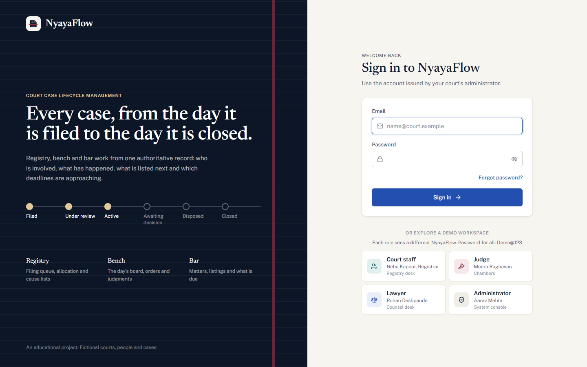 | 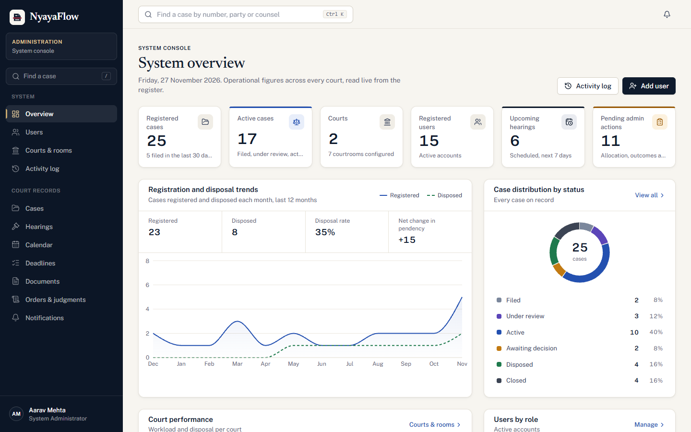 |
| **Sign in.** Show/hide password, validation and one-click demo workspaces. | **System console (administrator).** Trends, court performance, role mix, alerts and audit events. |
|  | 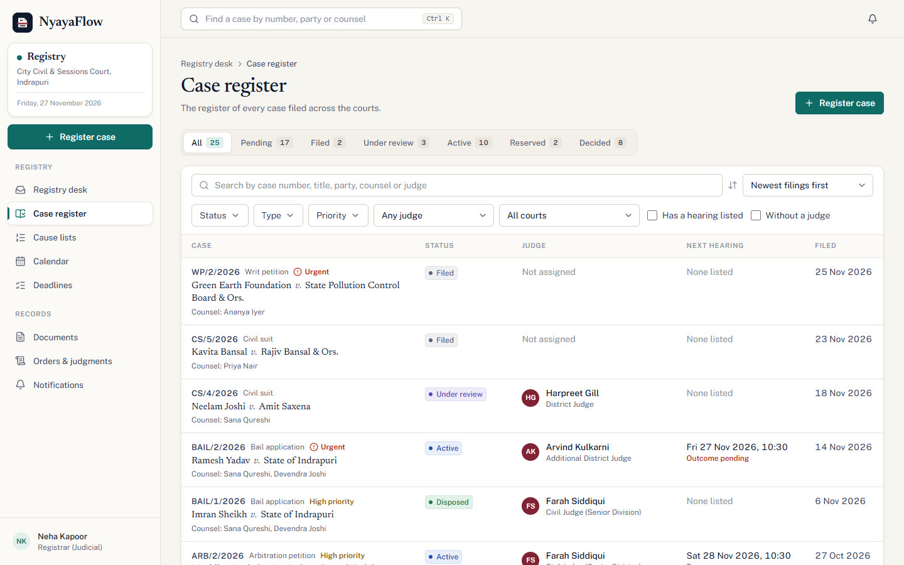 |
| **Registry desk (staff).** Quick actions, filing queue with next actions, today's cause list. | **Case register.** Status views with counts, search, filters, sorting and paging. |
| 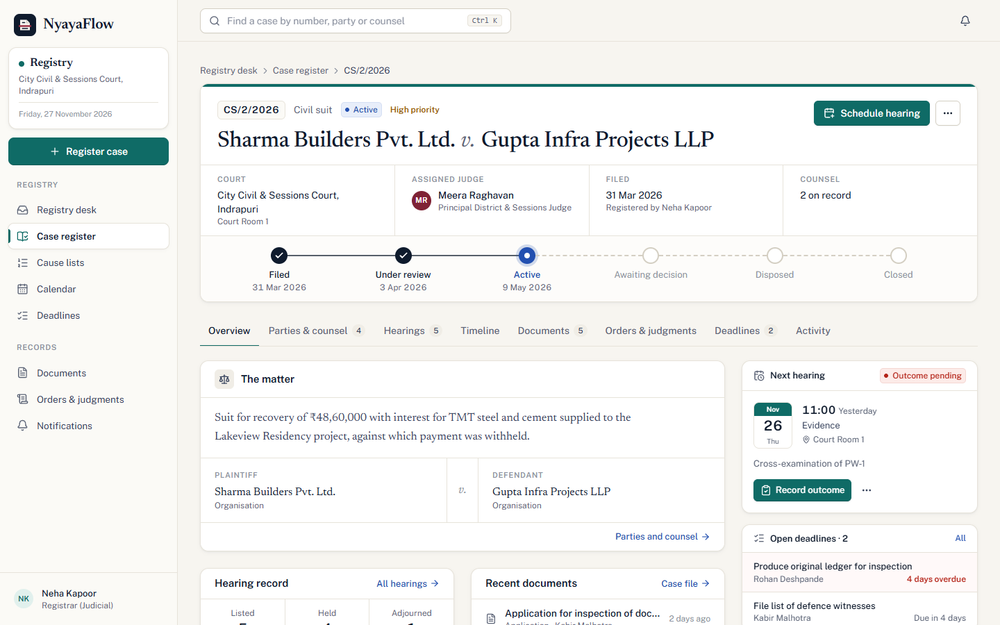 | 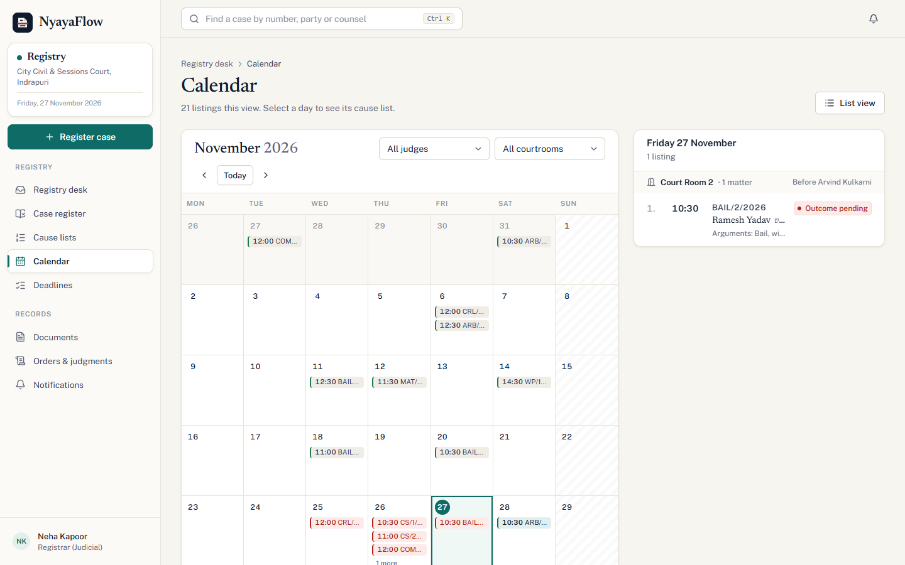 |
| **Case workspace.** Header facts, lifecycle strip, eight tabs and a summary rail. | **Calendar.** Month grid with a day cause list; outcome-pending listings flagged. |
| 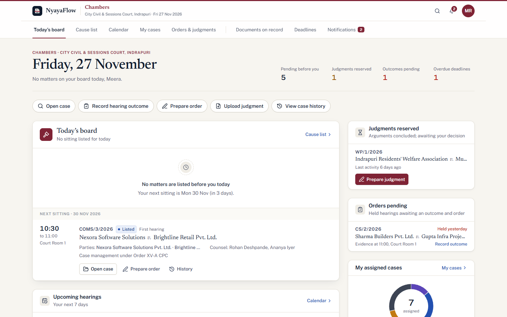 | 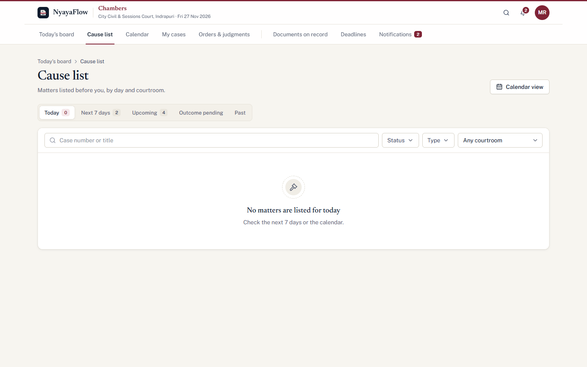 |
| **Chambers (judge).** A sidebar-free bench view centred on today's board. | **Cause list.** Listings by day and courtroom, printable. |
| 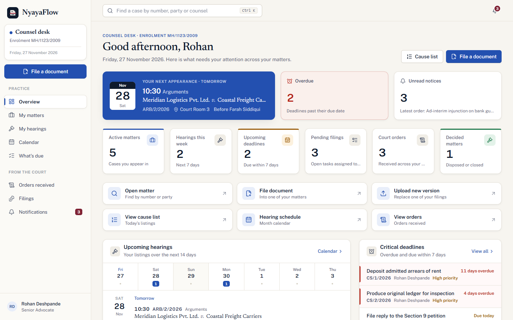 | 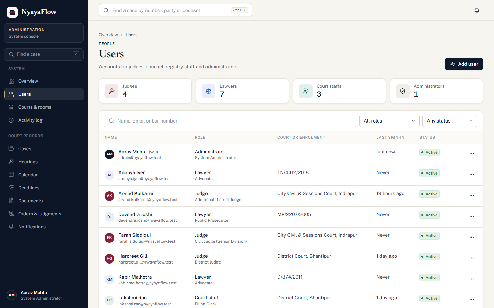 |
| **Counsel desk (lawyer).** Next appearance, what is overdue, matters, filings and orders. | **Users.** Role tiles, search and account actions. |

## The problem

A district court juggles hundreds of pending matters. For any one of them, people need to know at a
glance: what the case is, who is involved, who is hearing it, what has happened so far, what is
listed next, which documents and orders exist, which deadlines are approaching, and where the case
stands in its life. That information is usually spread across registers, cause lists, order sheets
and files, and each stakeholder sees a different, partial picture.

NyayaFlow models the **complete lifecycle of a case** and makes the case page the single place
where all of it comes together:

```
Filed → Under review → Active ⇄ Awaiting decision → Disposed → Closed
          (allocated)    (hearings,                  (final order   (record
                          evidence,                   or judgment)   consigned)
                          orders)
```

## Features

**Cases**
- Registration with automatic registry-style case numbers (`CS/142/2026`), parties on both sides,
  counsel, court and courtroom, and optional allocation to a judge.
- A case list built for hundreds of cases: free-text search across case number, title, party names,
  counsel and judge; filters by status, type, priority, judge, court, "has a hearing listed" and
  "without a judge"; sorting by filing date, next hearing, last update or title; pagination; and
  every filter kept in the URL so views can be bookmarked and shared.
- A case workspace organised into Overview, Parties & counsel, Hearings (with the order sheet of
  proceedings), Timeline, Documents, Orders & judgments, Deadlines and Activity, headed by the case
  facts and a **lifecycle strip** showing each stage the case has reached and the date it got
  there, with a summary rail (next hearing, open deadlines, latest order, counsel) beside every tab.
- Lifecycle rules enforced by the server: only valid transitions, and only by the right role
  (registry admits and closes; the presiding judge reserves and pronounces judgment).
- Optimistic concurrency on case edits, so two clerks cannot silently overwrite each other.

**Hearings**
- Schedule, reschedule (with a reason sent to the parties), cancel, and record the outcome.
- **Clash detection**: the scheduling form checks the judge's and the courtroom's board live as you
  pick a slot, and the server rejects a clash unless the user explicitly acknowledges it.
- Slot rules: future dates only, no Sundays, within court hours (configurable).
- A **"record outcome" workflow** that saves the result, the proceedings for that date and the next
  hearing in one atomic step.
- A daily **cause list** grouped by courtroom, list views (today, next 7 days, upcoming, outcome
  pending, past) and a month calendar with a day panel.

**Proceedings, orders and documents**
- Proceedings recorded per date in an order-sheet layout; the recorder can correct an entry while
  the case is open.
- Orders and judgments are append-only. A final order or judgment automatically disposes of the
  case and vacates any hearings still listed. Orders have a print-ready view.
- Documents with types, descriptions, **version history** (replace without losing earlier files),
  SHA-256 checksums, inline PDF/image preview, download, and soft deletion.

**Deadlines, notifications and activity**
- Deadlines with priority and an assignee who must be involved in the case. "Overdue" is derived
  from the due date, never stored, so it is always correct. A case cannot be closed while any of its
  deadlines is still open.
- A morning job (and one run at start-up) sends "deadline approaching" reminders once per deadline.
- In-app notifications for allocation, counsel changes, hearings, filings, proceedings, orders,
  status changes and deadlines, with an unread badge, a preview panel and a full inbox.
- An audit trail of every significant action (including sign-ins and failed sign-ins), shown per
  case and as a searchable system-wide activity log for administrators.

**Dashboards and workspaces**
- Each role has a different shell and home page, not just a different colour:
  - **Administrator — system console.** Dark sidebar; registration and disposal trends, case
    distribution by status, court performance (pending, decided, disposal share, hearings this week),
    pending cases per judge, users by role, pending administrative work, system alerts derived from
    live records, audit events and recent registrations.
  - **Court staff — registry desk.** Light working sidebar with *Register case*; quick actions
    (register, review filing, schedule hearing, assign judge, upload documents, prepare cause list),
    a filing queue of cases still with the registry with the next action for each, today's cause
    list, outcomes to record, deadlines, listing load and recently filed documents.
  - **Judge — chambers.** No sidebar; a quiet top navigation and today's board with time,
    courtroom, parties, counsel, hearing state and progress (or the next sitting when nothing is
    listed today), judgments reserved, outcomes and orders pending, assigned cases and recently
    opened cases.
  - **Lawyer — counsel desk.** Next appearance, overdue work and unread notices first; then active
    matters, hearings this week, a 7-day strip, critical deadlines, document submissions, received
    orders and notifications.
- Every figure is a live count from the API and links to the list it was counted from.
- Quick actions that need a case open a case picker, then the right form on that case's page
  (`/cases/{id}?action=schedule|assign|order|upload|deadline|conclude`), only if the server's
  permissions allow it.
- A command palette (`Ctrl K` / `⌘K` or `/`) to jump to any case from anywhere.

## Roles and what they can do

| | Administrator | Court staff | Judge | Lawyer |
|---|---|---|---|---|
| Sees | all cases | all cases | cases allocated to them | cases they appear in |
| Register / edit cases, manage counsel | ✓ | ✓ | | |
| Allocate or reassign a judge | ✓ | ✓ | | |
| Change status | admit, close | admit, close | activate, reserve, dispose | |
| Schedule / reschedule / cancel hearings | ✓ | ✓ | own cases | |
| Record hearing outcomes and proceedings | outcomes | ✓ | own cases | |
| Issue orders and judgments | | | own cases | |
| Upload documents | | ✓ | own cases | own cases |
| Set and edit deadlines | ✓ | ✓ | own cases | complete own |
| Manage users, courts and courtrooms; activity log | ✓ | | | |

Each role signs in to its own workspace (Administration, Registry, Chambers or Counsel desk) with
its own layout, accent colour, navigation and page names, and a dashboard built around that
person's work. Every rule is enforced by the API. The UI uses a `permissions` object that the server computes for
each case and user, so buttons are only shown when the action would succeed, but hiding a button is
never the protection.

## Running it

### Option A: everything in Docker (no Java or Node needed)

```bash
git clone https://github.com/Dhruv-ux-dev/nyayaflow.git
cd nyayaflow
cp .env.example .env              # optionally set NYAYAFLOW_JWT_SECRET
docker compose --profile app up --build
```

Open <http://localhost:8081>. The first start creates the schema and loads the demo data.

### Option B: local development

Requirements: **Java 25**, **Node.js 22.12+** (or 20.19+), and **Docker** for PostgreSQL (or any
PostgreSQL 15+ you already run).

1. Start the database:

   ```bash
   docker compose up -d db
   ```

2. Start the API (port 8080). The Maven wrapper downloads Maven on first use:

   ```bash
   cd backend
   ./mvnw spring-boot:run
   ```

   On first start Flyway creates the schema and the demo seeder loads two courts, sixteen users
   and twenty-five cases whose dates are relative to today, so the demo always looks current.

3. In a second terminal, from the project root, start the web app (port 5173), which proxies `/api`
   to the API:

   ```bash
   cd frontend
   npm install
   npm run dev
   ```

4. Open <http://localhost:5173> and use one of the demo accounts.

### Resetting the demo, or switching between A and B

Both options use the same PostgreSQL container and volume, but not the same upload directory: the
containerised API keeps files in the `uploads` volume, the local API in `backend/data/uploads`. A
database seeded by one setup therefore lists documents whose files the other cannot find. To start
again from a clean demo (and before switching setups), stop the API and remove both:

```bash
docker compose --profile app down -v
rm -rf backend/data
```

The next start of either setup recreates the schema, the demo data and its files.

## Demo accounts

All demo accounts use the password **`Demo@123`**. The sign-in page also has one-click buttons for
the first four.

| Role | Email | Person |
|---|---|---|
| Court staff | `staff@nyayaflow.test` | Neha Kapoor, Registrar (Judicial), Indrapuri |
| Judge | `judge@nyayaflow.test` | Meera Raghavan, Principal District & Sessions Judge |
| Lawyer | `lawyer@nyayaflow.test` | Rohan Deshpande, Senior Advocate |
| Administrator | `admin@nyayaflow.test` | Aarav Mehta |
| Judge | `arvind.kulkarni@nyayaflow.test`, `farah.siddiqui@nyayaflow.test`, `harpreet.gill@nyayaflow.test` | |
| Lawyer | `priya.nair@…`, `kabir.malhotra@…`, `sana.qureshi@…`, `vikram.rathore@…`, `ananya.iyer@…`, `devendra.joshi@…` | |
| Court staff | `suresh.pillai@…` (court master), `lakshmi.rao@…` (Shantipur) | |

`mohan.lal@nyayaflow.test` is a deactivated account, useful for seeing that sign-in is refused.

## A tour of the main workflow

1. **Staff** signs in and sees today's cause list, the allocation queue and pending outcomes.
2. *Register case* → parties, counsel, court → the case is issued a number and starts as **Filed**.
3. *Allocate to judge* → the case moves to **Under review**; the judge and counsel are notified.
4. *Schedule hearing* → pick a slot; a clash with the judge's or courtroom's board is flagged
   before you submit.
5. On the hearing day, *Record outcome* → result, proceedings and the next date in one step. The
   first completed hearing moves the case to **Active**.
6. **Lawyer** signs in, sees the listing and the notification, opens the case and uploads an
   affidavit; the judge is notified.
7. **Judge** marks the case **Awaiting decision** after final arguments, then *Issue order →
   Judgment*. The case is **Disposed** and any remaining listing is vacated.
8. **Staff** closes the case, which freezes the record. The **Timeline** tab shows the whole story,
   and the **Activity** tab shows who did what and when.

## Architecture

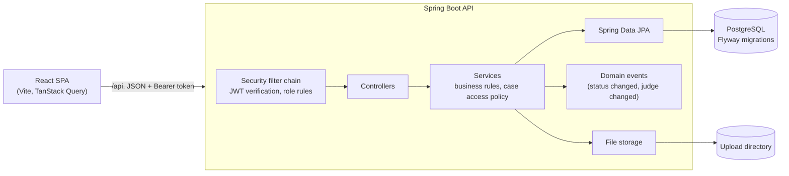

- **Single deployable API** (a modular monolith) organised **by feature**: `cases`, `hearing`
  (hearings and proceedings), `document`, `order`, `deadline`, `notification`, `audit`, `user`,
  `court`, plus composition packages `timeline` and `dashboard` that read across features.
- Each feature has its entities, repository, service (business rules and transactions), controller
  (HTTP only) and DTOs. Entities never leave the API; responses are explicit records.
- Cross-feature reactions use synchronous Spring events inside the same transaction (for example,
  disposing of a case vacates its hearings) so the case module does not depend on the hearing module.
- `audit` and `notification` reference cases and users by id with name snapshots, so they are leaf
  modules with no dependencies on the rest of the domain.
- The SPA talks to the API through one small fetch client that attaches the token, converts errors
  into a typed `ApiError`, and signs the user out on any 401. In development Vite proxies `/api`;
  in Docker, nginx serves the bundle and proxies `/api`, so the browser always sees one origin.

## Technology choices

| Area | Choice | Why |
|---|---|---|
| API | Spring Boot 4.1, Java 25 | Current LTS Java and Spring generation; mature validation, security and data access. |
| Persistence | PostgreSQL 17, Spring Data JPA (Hibernate 7) | A relational domain with real relationships; JPA Specifications for the dynamic search. |
| Schema | Flyway | Versioned SQL migrations; Hibernate only *validates* the schema. |
| Auth | Spring Security resource server, HS256 JWT (Nimbus, bundled with Spring Security) | Stateless bearer tokens without a third-party JWT library. |
| Web app | React 19, TypeScript, Vite 8 | Fast builds, typed API contracts. |
| Data fetching | TanStack Query | Caching, loading and error states, and refresh after every write. |
| UI | Tailwind CSS 4 with a small hand-built component set on Radix primitives | Accessible dialogs, menus and tabs with a visual identity specific to NyayaFlow rather than a stock admin theme. |
| Forms | React Hook Form | Lightweight forms; the server remains the source of validation and its field errors are mapped back onto the form. |
| Charts | Recharts (two charts) and plain HTML bars | Only where a chart helps; colours were checked with a colour-vision validator. |
| Tests | JUnit 5, MockMvc, Testcontainers | Integration tests run against real PostgreSQL. |

Deliberately **not** used: microservices, message brokers, Redis, cloud storage, Kubernetes. None
of them would make this application better at its job.

## Data model

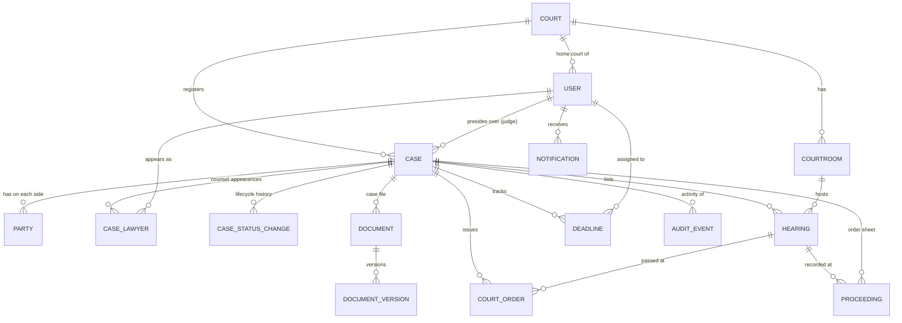

Notes on the model:

- **One role per user**, stored on the user. The four roles are fixed and drive code paths, so a
  roles table would add joins without adding flexibility. Bar numbers and home courts live on the
  user rather than in separate profile tables.
- **Parties and counsel belong to the case aggregate**; hearings, documents, orders, proceedings
  and deadlines are separate aggregates that reference the case.
- `cases.next_hearing_at` is a deliberate denormalisation, maintained by the hearing service, so
  the case list can sort and filter by next hearing without a subquery per row.
- `case_status_changes` keeps the lifecycle history that drives the lifecycle strip and timeline.
- `document_versions` keeps every upload; `documents.current_version` points at the latest.
- `case_number_counters` allocates `TYPE/SEQ/YEAR` numbers with a single atomic upsert.

## API overview

All endpoints are under `/api` and return JSON. Errors share one shape:

```json
{ "status": 409, "code": "SCHEDULING_CONFLICT", "message": "The judge or courtroom is already booked at this time.",
  "path": "/api/cases/9/hearings", "timestamp": "…", "fieldErrors": [ … ], "details": [ … ] }
```

| Area | Endpoints |
|---|---|
| Auth | `POST /auth/login`, `GET /auth/me`, `PUT /auth/me`, `PUT /auth/me/password` |
| Cases | `GET /cases` (search, filters, sort, paging), `POST /cases`, `GET/PUT /cases/{id}`, `PUT /cases/{id}/judge`, `POST /cases/{id}/lawyers`, `DELETE /cases/{id}/lawyers/{lawyerId}`, `POST /cases/{id}/status`, `GET /cases/{id}/timeline`, `GET /cases/{id}/activity` |
| Hearings | `GET/POST /cases/{id}/hearings`, `GET /hearings` (date range, status, type, judge, courtroom), `GET /hearings/calendar`, `GET /hearings/conflicts`, `GET /hearings/{id}`, `POST /hearings/{id}/reschedule`, `POST /hearings/{id}/cancel`, `POST /hearings/{id}/conclude` |
| Proceedings | `GET/POST /cases/{id}/proceedings`, `PUT /proceedings/{id}` |
| Orders | `GET/POST /cases/{id}/orders`, `GET /orders`, `GET /orders/{id}` |
| Documents | `GET/POST /cases/{id}/documents` (multipart), `GET /documents`, `GET/PUT/DELETE /documents/{id}`, `POST /documents/{id}/versions`, `GET /documents/{id}/download` |
| Deadlines | `GET/POST /cases/{id}/deadlines`, `GET /deadlines?view=OPEN\|OVERDUE\|DUE_SOON\|COMPLETED\|ALL`, `PUT/DELETE /deadlines/{id}`, `POST /deadlines/{id}/complete`, `POST /deadlines/{id}/reopen` |
| Notifications | `GET /notifications`, `GET /notifications/unread-count`, `POST /notifications/{id}/read`, `POST /notifications/read-all` |
| Dashboard | `GET /dashboard` (shaped per role) |
| Administration | `GET/POST /users`, `GET/PUT /users/{id}`, `POST /users/{id}/deactivate`, `POST /users/{id}/activate`, `POST /users/{id}/reset-password`, `GET /directory/users?role=`, `GET/POST /courts`, `PUT /courts/{id}`, `POST /courts/{id}/courtrooms`, `PUT /courtrooms/{id}`, `GET /audit` |

`GET /actuator/health` reports liveness for container orchestration.

## Key design decisions

1. **Lifecycle stage, not schedule, is the status.** The suggested "Hearing scheduled" status was
   replaced by deriving "next hearing" from the hearing records. A status that duplicates the
   schedule drifts out of sync the moment a hearing is cancelled or adjourned.
2. **The server computes permissions.** `CaseAccess` is the single source of who can see and do what
   with a case. It filters every query (`CaseScope`), guards every write, and produces the
   `permissions` object the UI renders from. The UI never re-implements the rules.
3. **Role checks happen before validation.** URL rules in the security filter chain reject, for
   example, a lawyer's `POST /cases` with 403 before the body is parsed, so the API never reveals
   its validation rules to someone who may not call it. Method-level `@PreAuthorize` and the
   service-level access policy are further layers.
4. **Workflows are atomic.** Concluding a hearing (result, proceedings, next date), issuing a final
   judgment (order, disposal, vacating hearings) and registering a case (number, parties, counsel,
   allocation, notifications, audit) each happen in one transaction.
5. **Judicial records are append-only.** Orders cannot be edited or deleted; documents are versioned
   and soft-deleted; status changes and audit events are never updated.
6. **Derived over stored.** Overdue deadlines and "outcome pending" hearings are computed from dates,
   so no batch job is needed to keep them correct.
7. **Court-local time.** Hearing times are stored as court wall-clock times (`Asia/Kolkata` by
   default), and system timestamps as instants. A reviewer in another time zone sees "10:30" for a
   10:30 listing.
8. **Demo data is replayed, not inserted.** The seeder describes each case as a script of events
   relative to today and replays them through the same lifecycle rules, producing consistent status
   history, audit trail, notifications and real PDF files.

## Security

- Passwords are hashed with BCrypt (Spring's delegating encoder, so the algorithm can be upgraded).
- Stateless HS256 tokens with an issuer check and an 8-hour lifetime. On every request the user is
  reloaded, so **deactivation, role changes and password resets take effect immediately**: each
  token carries the account's credentials stamp, and a token whose stamp no longer matches is
  rejected, even one issued a moment before the change.
- Sign-in returns the same message for an unknown email and a wrong password, and compares against
  a dummy hash for unknown emails so response time does not reveal which accounts exist. Five failed
  attempts lock an email for five minutes.
- Uploads are limited to allowed extensions and 20 MB, stored under generated names outside the web
  root, and rejected if the file's first bytes do not match its extension. Downloads are sent as
  attachments with `nosniff` (only PDFs and images can be shown inline).
- Errors never include stack traces or SQL; unexpected errors are logged server-side.
- Request bodies are validated with Bean Validation; search terms are escaped for `LIKE`; sort
  fields are allow-listed.
- The token is kept in `localStorage` for simplicity. That is exposed to any script injected into the
  page; React escapes all rendered content and the app renders no user-supplied HTML, but an
  HttpOnly-cookie session would be the next step for a production system.

## Testing

```bash
cd backend
./mvnw test        # requires Docker for the PostgreSQL test container
```

41 tests, most of them end-to-end through HTTP against a real PostgreSQL in Testcontainers:

- **Authentication**: sign-in, generic failure messages, deactivated accounts, missing and forged
  tokens, revocation after a password reset (even within the same second) or deactivation.
- **Authorization**: administrator-only endpoints, role checks before validation, case visibility
  for lawyers and judges, only the presiding judge issuing orders, per-case permission objects.
- **Case lifecycle**: case numbering and allocation (with notifications), party rules, scheduling
  clashes and overrides, court-hours and Sunday rules, hearing times stored exactly as entered,
  the atomic hearing conclusion, final judgment disposing and vacating, valid transitions by role.
- **Deadlines**: derived overdue status, assignee rules, counsel completing but not editing,
  one-time reminders, no closing a case while a deadline is open.
- **Documents**: upload and byte-exact download, path-traversal-safe file names, type allow-list and
  content-signature checks, access control.

The web app is type-checked with `npm run typecheck`, linted with `npm run lint` and built with
`npm run build`; it has no automated UI tests.

## Project structure

```
nyayaflow/
├── docker-compose.yml          # db (default) and the full stack (profile "app")
├── .env.example
├── backend/
│   ├── pom.xml, mvnw, Dockerfile
│   └── src/main/java/com/nyayaflow/
│       ├── auth/               # sign-in, profile, password change
│       ├── audit/              # activity trail
│       ├── cases/              # case aggregate, access policy, search, lifecycle
│       ├── common/             # error model, paging, shared helpers
│       ├── config/             # typed configuration, clock
│       ├── court/              # courts and courtrooms
│       ├── dashboard/          # role-specific dashboards (composition)
│       ├── deadline/           # deadlines and the reminder job
│       ├── document/           # documents, versions, file storage
│       ├── hearing/            # hearings, proceedings, scheduling rules
│       ├── notification/       # in-app notifications
│       ├── order/              # orders and judgments
│       ├── security/           # JWT, principal, filter chain, login throttling
│       ├── seed/               # demo data scripts and replay
│       ├── timeline/           # case timeline (composition)
│       └── user/               # accounts and directory
│   └── src/main/resources/db/migration/   # Flyway SQL
└── frontend/
    ├── Dockerfile, nginx.conf
    └── src/
        ├── api/                # typed endpoint hooks (TanStack Query)
        ├── auth/               # session, guards
        ├── components/         # ui kit, layout, domain components
        ├── features/           # one folder per screen area
        └── lib/                # API client, types, labels, formatting
```

## Configuration reference

| Variable | Default | Purpose |
|---|---|---|
| `DB_URL` | `jdbc:postgresql://localhost:5432/nyayaflow` | JDBC URL |
| `DB_USERNAME` / `DB_PASSWORD` | `nyayaflow` / `nyayaflow` | Database credentials |
| `NYAYAFLOW_JWT_SECRET` | *(random per start)* | Token signing key, at least 32 bytes (plain or Base64). Set it outside local development. |
| `NYAYAFLOW_JWT_TTL` | `8h` | Session lifetime |
| `NYAYAFLOW_STORAGE_LOCATION` | `./data/uploads` | Where uploaded files are stored |
| `NYAYAFLOW_MAX_UPLOAD_SIZE` | `20MB` | Largest file that can be uploaded |
| `NYAYAFLOW_MAX_REQUEST_SIZE` | `21MB` | Whole upload request; keep it a little above the file limit |
| `NYAYAFLOW_TIMEZONE` | `Asia/Kolkata` | Court time zone for hearing times and "today" |
| `NYAYAFLOW_CORS_ALLOWED_ORIGINS` | `http://localhost:5173` | Only needed if the web app is served from another origin |
| `NYAYAFLOW_SEED_DEMO_DATA` | `true` | Load demo data into an empty database |
| `PORT` | `8080` | API port |
| `VITE_API_PROXY_TARGET` | `http://localhost:8080` | Where the Vite dev server forwards `/api` |
| `VITE_SHOW_DEMO_ACCOUNTS` | `true` | Show demo sign-in buttons (set `false` for real use) |

Court hours (`09:30–17:30`), the default hearing length and the reminder window are in
`backend/src/main/resources/application.yml` under `nyayaflow.scheduling` and `nyayaflow.deadlines`.

## Known limitations

- Single-instance assumptions: the sign-in throttle is in memory and files are on local disk.
- Notifications are polled every 30 seconds rather than pushed.
- No email or SMS delivery; notifications are in-app only.
- Court transfers and change of case type after registration are not supported.
- Clash detection works on fixed time slots. Real cause lists often list many matters in the same
  courtroom at the same time; a production system would model sessions rather than slots.
- No dark mode, internationalisation or Hindi/regional-language interface.
- "Recently opened" cases on the judge's board are remembered in the browser only, because the API
  does not record case views.

## Future improvements

- HttpOnly-cookie sessions with refresh tokens, and optional two-factor sign-in for judges.
- Server-sent events for live notifications and cause-list updates.
- Object storage (S3-compatible) for documents, with virus scanning on upload.
- Printable daily cause lists per courtroom and certified copies of orders as PDFs.
- Full-text search over document contents and order text (PostgreSQL `tsvector`).
- Case transfer between courts, connected matters, and caveats.
- E-filing by lawyers with registry scrutiny before registration.
- Reporting: pendency by age bucket, adjournment rates, disposal rates per judge.

## Author

**Dhruv Mittal** designed and built NyayaFlow: the Spring Boot API, the PostgreSQL schema,
the React web app and the Docker setup.

## License

Released under the [MIT License](LICENSE).
